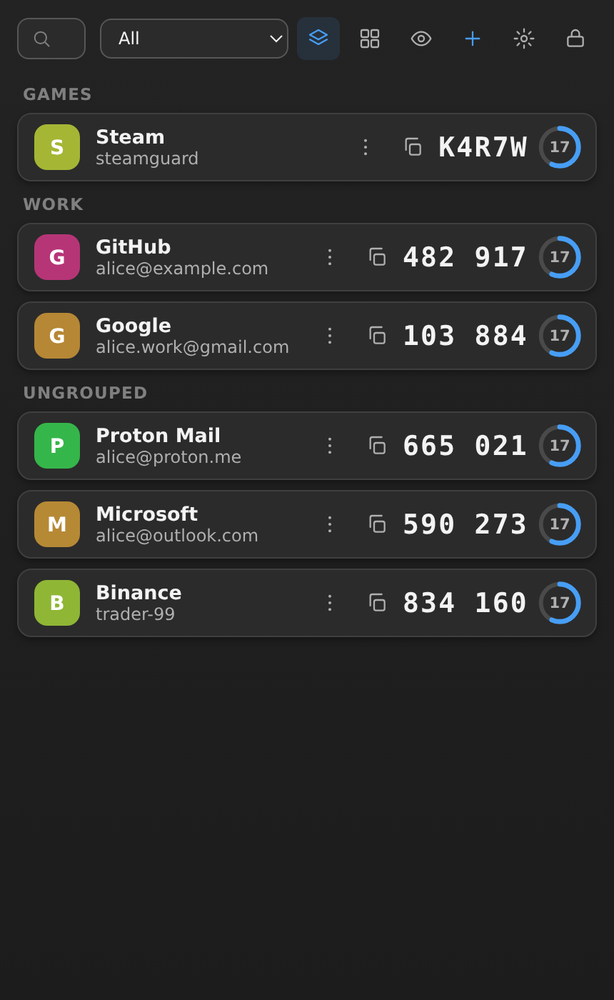

<p align="center">
  
</p>
<h1 align="center">Authio</h1>
<p align="center">
  A tiny, fast, secure, open-source 2FA authenticator for Windows.<br/>
  <b>Rust</b> + <b>Tauri</b> + <b>TypeScript</b> — fully offline, no accounts, no telemetry.
</p>

<p align="center">
  
</p>

---

## Features

### Core
- **TOTP (RFC 6238)** — SHA-1 / SHA-256 / SHA-512, 6/8 digits, 15/30/60 s and custom periods, verified against the official RFC test vectors in CI.
- **HOTP (RFC 4226)** counter-based codes, one tap per code.
- **Add accounts** by QR image (PNG/JPEG), `otpauth://` link, or manual Base32 secret — with validation before anything is stored.
- **Live list** with one-tap copy, countdown ring, per-second refresh, and codes hidden until you reveal them.
- **Manage**: edit, delete (with confirmation), pin, drag-and-drop reorder, alphabetical sort, instant search.

### Security
- Vault encrypted with **AES-256-GCM**; key derived with **Argon2id** (64 MiB / 3 / 4) from your master password — or a random key sealed in the **Windows Credential Manager**.
- **Secrets never leave the Rust core**: the UI receives only generated codes, never raw secrets. Revealing a secret or exporting requires re-authentication.
- **Auto-lock** on idle and on minimize; memory is wiped (`zeroize`) on lock.
- **Screen-capture protection** on Windows (window shows black to screenshots/screen-share).
- Zero network access. Strict CSP. No logs of secrets or codes. Atomic vault writes with automatic `.bak`.

### Import / Export (preview → duplicate detection → confirm before anything is applied)
| Format | Import | Notes |
|---|---|---|
| **Authio backup** | ✅ encrypted & plain | documented, versioned format |
| **Google Authenticator** | ✅ `otpauth-migration://` QR/URI | built-in protobuf parser |
| **Aegis** | ✅ plain & encrypted vault | scrypt + AES-256-GCM slots |
| **Authme** | ✅ export JSON | tolerant field mapping |
| **2FAS** | ✅ plain backup JSON | encrypted 2FAS exports are rejected with a hint |
| **andOTP** | ✅ plain backup JSON | |
| **Raivo** | ✅ `raivo-otp-export.json` | |
| **Bitwarden** | ✅ vault-export CSV (`login_totp`) | TOTP URIs or raw seeds |
| **Steam (maFile)** | ✅ SDA `shared_secret` JSON | imported as Steam-style 5-character codes |
| **otpauth lines** | ✅ lists of URIs | |
| **Export** | encrypted (recommended) or plain JSON, your choice | plain export requires explicit acknowledgement |

### UI
- **Fluent 2** design language: compact list, Segoe UI Variable, 8 px radii, light/dark/system themes.
- **9 UI languages** — English, Deutsch, Español, Français, 日本語, 한국어, Português, Русский, 简体中文 (switch live in Settings).
- Density toggle (compact/comfortable), code font-size slider, window size & position restored on launch.
- Keyboard shortcuts: `Ctrl+F` search · `Enter` reveal/copy · `Ctrl+L` lock · `Ctrl+,` settings.

## Download

Prebuilt binaries are published in [**Releases**](https://github.com/Arvanta/Authio/releases):

- `Authio_x.x.x_x64-setup.exe` — NSIS installer
- `authio-windows-portable.zip` — portable build (no install; data still lives in `%APPDATA%`)

## Build from source

Prerequisites: [Node.js 20+](https://nodejs.org), [Rust (stable)](https://rustup.rs), Windows 10/11 with WebView2.

```bash
git clone https://github.com/Arvanta/Authio.git
cd Authio
npm install
npm run tauri dev     # development
npm run tauri build   # production bundle (NSIS installer in src-tauri/target/release/bundle)
```

Run the core test suite (OTP RFC vectors, crypto round-trips, importer fixtures):

```bash
cd src-tauri && cargo test
```

## Repository layout

```
Authio/
├── src/                  # TypeScript UI (framework-free, Vite)
│   ├── locales/en.json   # all UI strings (i18n-ready)
│   └── ...
├── src-tauri/            # Rust core
│   └── src/
│       ├── otp.rs        # RFC 4226/6238 (hand-written, test-vectored)
│       ├── crypto.rs     # AES-256-GCM, Argon2id, scrypt, CSPRNG
│       ├── vault.rs      # encrypted envelope + atomic persistence
│       ├── otpauth.rs    # otpauth:// URIs + tolerant Base32
│       ├── migration.rs  # Google migration protobuf parser
│       ├── importers.rs  # Authio / Aegis / Authme / Google / otpauth-list
│       ├── commands.rs   # Tauri IPC surface (secrets never leave here)
│       └── ...
├── docs/
│   ├── SPEC.md           # feature specification (MVP / v1.x / v2+)
│   ├── BACKUP-FORMAT.md  # documented backup format
│   └── SECURITY.md       # security model & hardening notes
└── .github/workflows/    # CI: tests + Windows NSIS + portable zip → Releases
```

## Roadmap

See [`docs/SPEC.md`](docs/SPEC.md) — next up: Windows Hello unlock, webcam QR scan, Farsi/RTL localization, local-first sync.

## License

[MIT](LICENSE) © 2026 Arvanta
